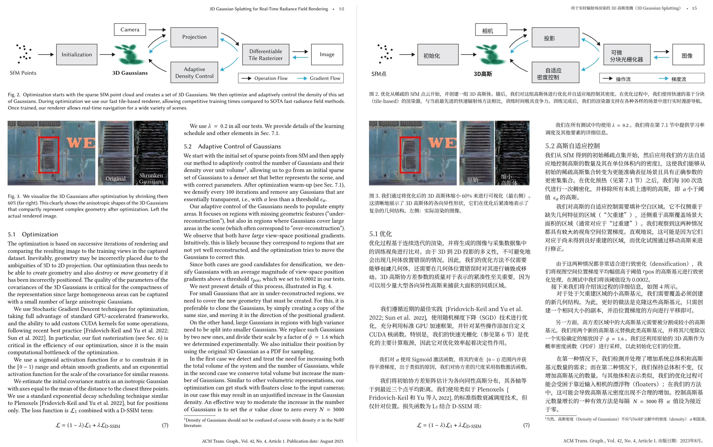
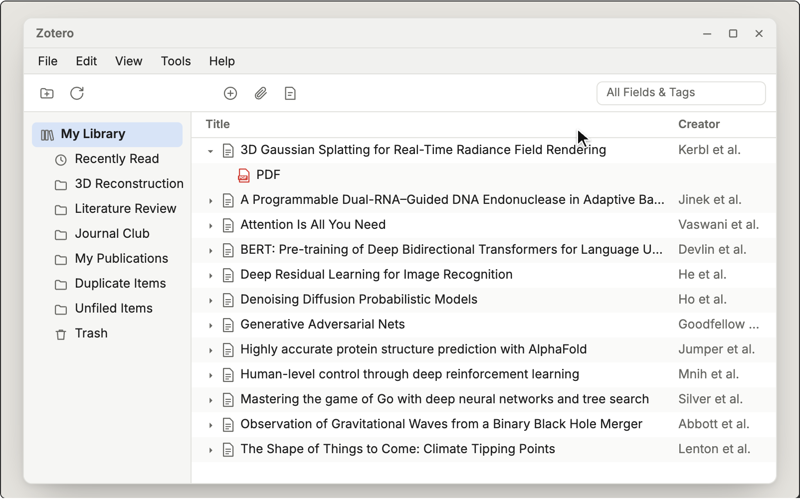

# CocoTranslate for Zotero

 

[简体中文](README.md)

Get high-quality AI translations of your PDF papers in Zotero with one click

 
Page 5 of Kerbl et al., <a href="https://arxiv.org/abs/2308.04079">3D Gaussian Splatting for Real-Time Radiance Field Rendering</a>, <a href="https://creativecommons.org/licenses/by/4.0/">CC BY 4.0</a>, translated into Simplified Chinese

## Install

1. Download [cocotranslate.xpi](https://github.com/iftechio/zotero-cocotranslate/releases/latest/download/cocotranslate.xpi)
2. In Zotero, open Tools › Plugins, click the gear icon and choose Install Plugin From File…, then pick the downloaded file

Works with Zotero 7, 8, 9 and 10. A step-by-step guide is at [cocotranslate.com/en/zotero](https://cocotranslate.com/en/zotero).

## Use

Right-click a paper › CocoTranslate › Bilingual PDF / Translation-only PDF. Several papers can be selected at once.

## License

[MIT](LICENSE)
