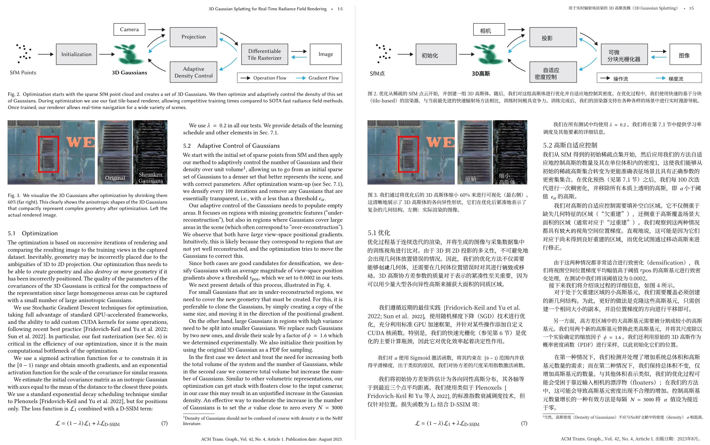
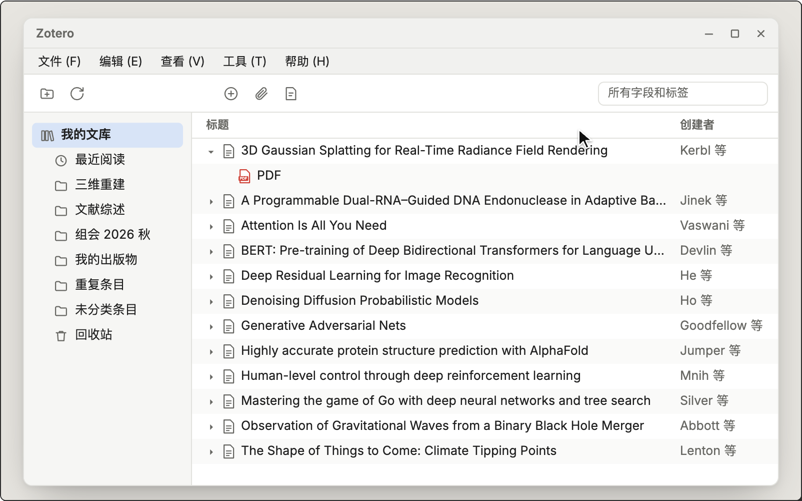

# 椰子翻译 Zotero 插件

  

[English](README.en.md)

在 Zotero 中一键获取 AI 精译 PDF 文献

 
示例页出自 Kerbl 等，<a href="https://arxiv.org/abs/2308.04079">3D Gaussian Splatting for Real-Time Radiance Field Rendering</a>，第 5 页，<a href="https://creativecommons.org/licenses/by/4.0/">CC BY 4.0</a>，译成简体中文

## 安装

1. 下载 [cocotranslate.xpi](https://github.com/iftechio/zotero-cocotranslate/releases/latest/download/cocotranslate.xpi)
2. 在 Zotero 菜单里打开「工具 › 插件」，点右上角的齿轮，选 Install Plugin From File…，选中下载的文件

支持 Zotero 7、8、9、10。图文教程见 [cocotranslate.com/zotero](https://cocotranslate.com/zotero)。

## 使用

右键点击文献 › 椰子翻译 › 双语对照版 / 纯译文版。可以一次选中多篇。

## 许可证

[MIT](LICENSE)
